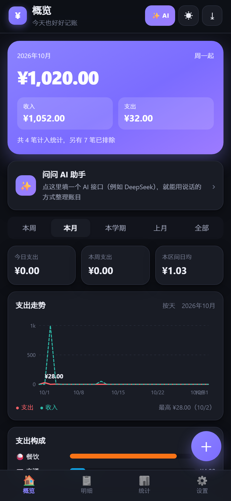
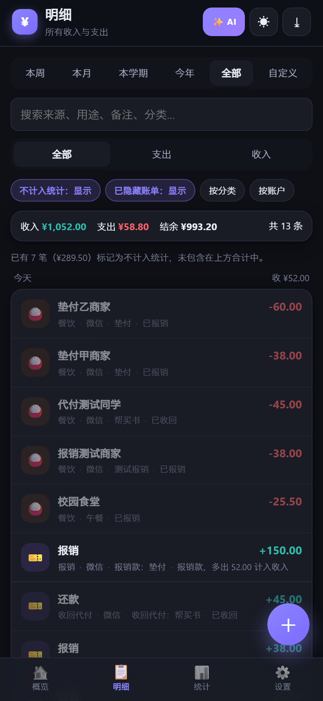
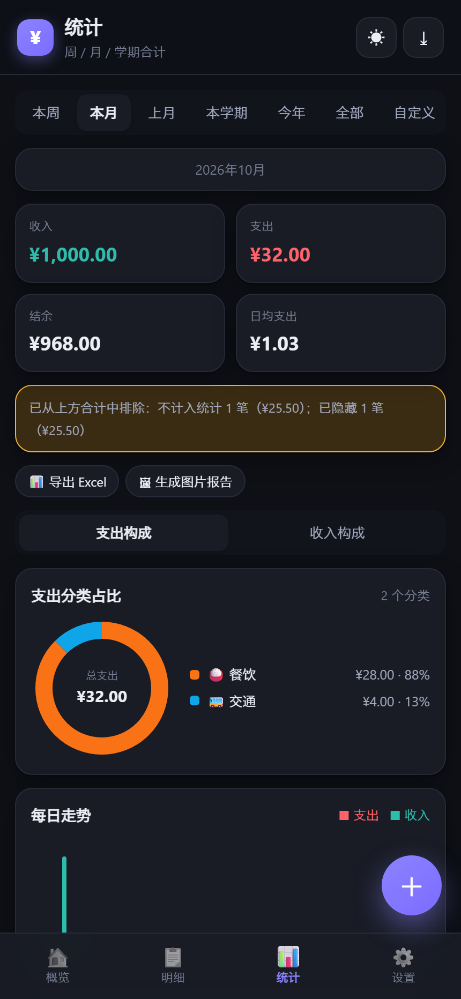
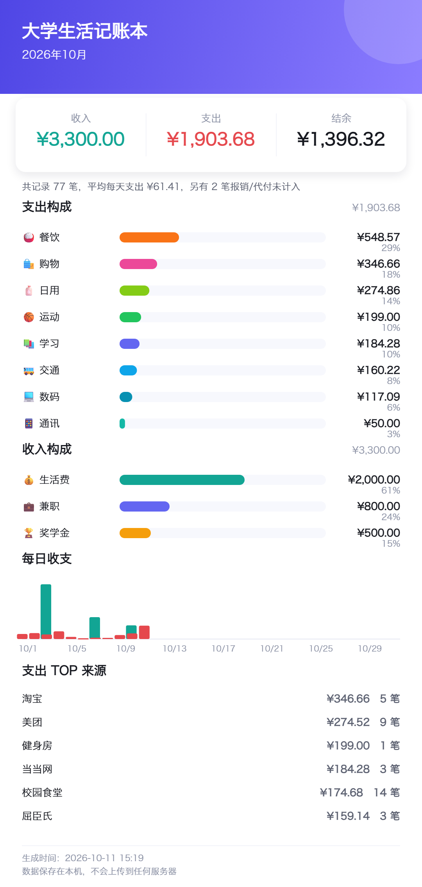

# 大学生活记账本

一个**完全离线、数据只存在自己设备上**的记账应用。
电脑和安卓手机上都能用，功能一致，两边可以互相同步，并且都有自动备份。

| 概览 | 明细 | 统计 | 给家人看的报告 |
| --- | --- | --- | --- |
|  |  |  |  |

---

## 先看这里：安卓安装包（APK）

**安装包位置：`dist/记账本-v1.1.0.apk`**

1. 把 APK 传到手机上（微信文件传输助手、数据线、QQ 都行）
2. 手机上点开安装，提示"未知来源应用"时选**允许**
3. 桌面出现「记账本」图标，点开即可使用

装好之后：**不需要电脑，不需要 WiFi，不需要流量，飞行模式下也能记账**。
数据存在手机本地，另外会自动往手机的「下载」目录写备份文件。

---

## 功能一览

### 记账
- 记收入 / 支出，金额、时间、分类、账户一次填完
- 日期时间用的是**自己画的日历面板**，不是系统原生控件，手机上不再弹出又丑又挡屏的系统选择器
- 每笔账单分开记录 **来源**（交易对方 / 商家）和 **用途**（买了什么 / 做什么）

### 微信、支付宝账单导入
- 直接导入微信支付的账单 CSV（UTF-8）和支付宝的账单 CSV（**GBK 编码自动识别**）
- 内置 19 组关键词自动分类，可自定义规则
- **两级重复识别**：交易单号相同 → 标记「重复」；同一天同金额 → 标记「疑似重复」。
  两者默认都不勾选，避免"先手动记了一笔、后来又导入账单"造成的重复记账
- 导入前有预览表格，可逐条改分类、勾选要导入的条目

### 报销 / 隐藏 / 不计入统计
- **报销配对**：支出标记「待报销」后立即从所有合计中排除；收到钱时点「收到报销款」，
  自动生成配对的报销收入，**收支两笔都不计入本月账单**，但记录完整保留
- 其它排除原因：代付、借还款、账户互转、不计收支
- 单笔账单可隐藏；分类可整类隐藏，也可设为默认不计入统计
- 统计页明确写出「已排除 N 笔（¥X）」，随时可取消报销恢复计入

### 周期统计
- 本周、本月、上月、**本学期**（起止日期可自定义）、今年、全部、自定义区间
- 收入 / 支出 / 结余 / 日均支出，分类占比环形图、收支趋势图、支出 TOP 来源、账户分布

### 导出报表（给爸妈看）
- **导出 Excel**：真正的 `.xlsx` 文件，含 4 个工作表（周期汇总、账目明细、分类汇总、每日收支），
  Excel / WPS 直接打开，中文不乱码
- **生成图片报告**：一页纸的收支报告（1080 宽 PNG），浅色配色，直接发微信给父母看

### 电脑与手机同步
- 手机 App 里填上电脑的地址和口令，就能把两边数据合并到一起
- **自动比较新旧**：逐条比较「最后修改时间」，新的那份胜出；删除也会同步过去，不会"复活"
- 打开应用时自动同步一次，记账之后也会自动同步
- 也可以只用浏览器同步（手机浏览器打开电脑的服务即可）

### 自动备份（电脑和手机都有）
| 位置 | 方式 |
| --- | --- |
| 手机 App | 自动把整份数据存成快照，同时往手机「下载」目录写一份 JSON 备份文件 |
| 手机 / 电脑浏览器 | 自动在本机数据库里保留最近 N 份快照，可在「自动备份 → 备份管理」里一键还原 |
| 电脑服务端 | 每次同步后自动在 `backups/` 目录留档，最多保留 30 份 |

### 访问控制
- 局域网访问需要**访问口令**（首次启动自动生成 6 位数字，显示在电脑的命令行窗口里）
- 勾选「记住这台设备」后长期免输，**自动登录**
- 电脑本机访问免口令；连续输错 8 次会锁定 5 分钟
- 口令保存在 `.server.json`，可随时修改

---

## 快速开始

### 电脑上运行

双击 `启动记账本.bat`，命令行窗口会显示：

```
电脑上打开：http://127.0.0.1:8788/   （本机免口令）

手机上打开（需与电脑在同一 WiFi）：
  http://192.168.1.7:8788/

┌──────────────────────────────────────────────┐
│   手机首次访问需要输入访问口令                │
│       口  令 ： 482915                        │
└──────────────────────────────────────────────┘
```

手机浏览器打开上面的地址 → 输入口令 → 勾选「记住这台设备」→ 以后再打开就不用输了。

### 手机 APK 连电脑同步

1. 在 APK 里进入 **设置 → 与电脑同步 → 同步设置**
2. 填「电脑地址」（如 `192.168.1.7:8788`）和窗口里显示的 6 位口令
3. 点「连接并同步」

之后手机不用打开浏览器，直接点桌面图标就能记账并同步。

---

## 目录结构

```
大学生活记账本/
├── dist/                       打包好的安卓安装包
├── web/                        网页应用本体（纯静态，零依赖）
│   └── js/
│       ├── util.js             工具函数
│       ├── defaults.js         预设分类与规则
│       ├── db.js               存储层（IndexedDB + 降级）
│       ├── store.js            业务状态（账目/分类/报销/删除标记/合并）
│       ├── importer.js         账单导入引擎（含两级重复识别）
│       ├── stats.js            周期与统计计算
│       ├── sync.js             设备同步（上传/下载/冲突合并）
│       ├── backup.js           自动备份
│       ├── xlsx.js             自己生成 Excel 文件（零依赖）
│       ├── report.js           导出 Excel 与图片报告
│       ├── datetime.js         自绘日期时间选择器
│       ├── ui.js               全部界面与交互
│       └── app.js              启动、路由、主题
├── android-src/                安卓外壳（原生 WebView，无第三方依赖）
├── tools/
│   ├── serve.js                本地服务器：口令、同步接口、自动备份
│   ├── build-apk.js            打包 APK（不需要 Gradle）
│   ├── verify-apk.js           校验 APK 结构与签名
│   ├── get-buildtools.js       下载 JDK 与安卓 SDK
│   ├── browser-test.js         浏览器端到端测试
│   ├── sample-report.js        用示例数据生成报表图
│   └── ziplib.js / make-*.js   打包与图标工具
├── tests/
│   ├── core.test.js            核心逻辑测试（71 项）
│   ├── server.test.js          服务器测试（29 项）
│   ├── browser-suite.js        端到端测试脚本（100 项）
│   └── fixtures/               微信 / 支付宝账单样例
├── docs/                       使用说明、导入指南、打包指南、截图
└── 启动记账本.bat
```

---

## 测试

```bash
npm test                  # 核心逻辑测试（71 项，纯 Node）
npm run test:server       # 服务器测试（29 项：口令、同步、冲突合并、备份）
npm run test:browser      # 浏览器端到端测试（100 项，会启动无头 Chrome 并截图）
npm run test:all          # 前两项
```

端到端测试会真实地走完整流程（记账、报销、导入、统计、导出 Excel、生成图片、备份还原、
日期选择器、同步面板），并检查无横向溢出、无控制台报错。

---

## 重新打包 APK

```bash
npm run apk:tools     # 首次：下载 JDK 与安卓 SDK 到 .buildtools（约 400MB）
npm run apk:build     # 打包，产物在 dist/
npm run apk:verify    # 校验 APP 结构、资源与签名
```

打包**不需要 Gradle，也不需要下载任何第三方库**。详见 [docs/Android打包指南.md](docs/Android打包指南.md)。

---

## 数据与隐私

- 所有数据保存在设备本地，不上传任何服务器；同步只在你自己的电脑和手机之间进行
- 安卓外壳会拦截一切非局域网请求，应用无法访问公网
- `.gitignore` 已排除 `.server.json`、`.sync-data.json`、`backups/` 与各类备份文件
- 建议保持自动备份开启；换设备时用「从备份恢复」搬运数据

---

## 常见问题

**Q：手机第一次打开要输口令，以后还要输吗？**
不用。勾选「记住这台设备」后会长期免输（Cookie 有效期一年）。换了浏览器或清了浏览数据就要再输一次。

**Q：忘记了访问口令？**
口令显示在电脑上运行服务的窗口里；也可以打开项目根目录的 `.server.json` 查看。
删掉这个文件再重启服务会生成新口令。

**Q：执行了一次"清空全部数据"，还能恢复吗？**
能。清空操作会保留应用内的备份快照，去「设置 → 自动备份 → 备份管理」里选一个时间点还原即可。

**Q：手动记的账和导入的账单重复了怎么办？**
导入时同一天同金额的记录会被标成「疑似重复」并自动取消勾选，确认不是同一笔再手动勾上即可。
已经重复了的话，用「设置 → 清理演示/重复数据」一键清理。

**Q：同步会不会把我手机上的数据覆盖掉？**
不会。同步是逐条比较「最后修改时间」后合并，两边独有的记录都会保留，冲突时保留后改的那一份。

**Q：支付宝账单导入乱码？**
支付宝导出的是 GBK 编码，应用已自动识别。仍然乱码说明浏览器太旧，换 Chrome / Edge 或直接用 APK。

**Q：APK 安装时提示"未知来源"？**
这是安卓对非应用商店安装包的标准提示，选择允许即可。应用是自签名的，没有上架应用商店。